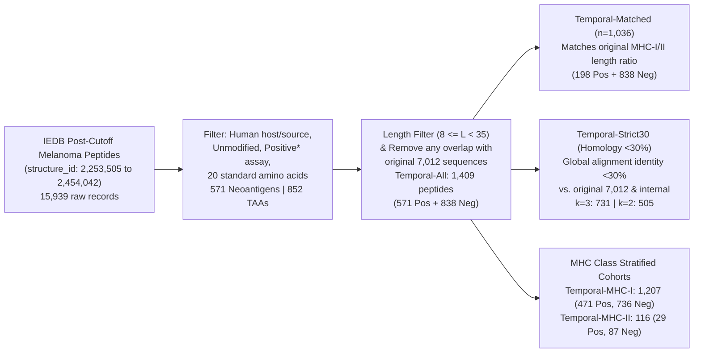
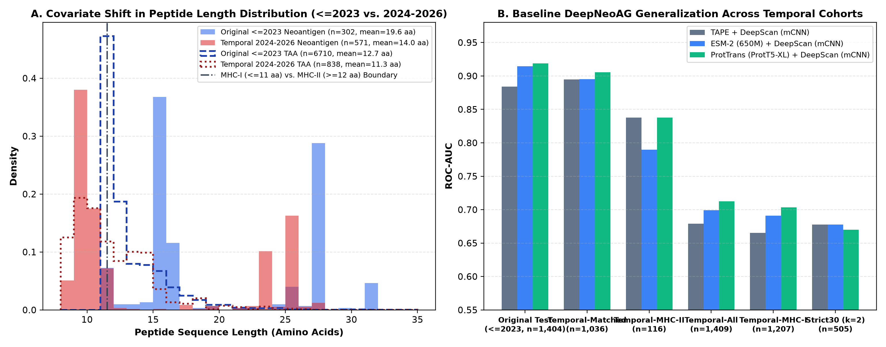
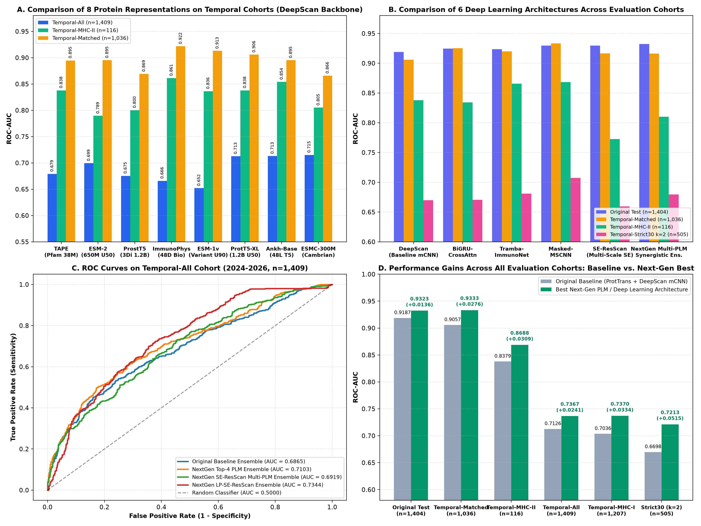

# Student Lab Manual & Methodology Guide: Neoantigen Immunogenicity Prediction, Temporal Benchmark Construction, and Next-Generation Protein Language Models & Deep Learning Architectures

---

## 1. Introduction & Biological Problem Formulation

In cancer immunotherapy—including personalized mRNA cancer vaccines and adoptive T-cell therapies—a critical computational bottleneck is distinguishing **immunogenic Neoantigens** (somatic mutation-derived tumor peptides capable of eliciting a functional T-cell response) from **non-neoantigen Tumor-Associated Antigens (TAAs / wild-type self-peptides)**.

While traditional tools (such as NetMHCpan or MHCflurry) predict **peptide–MHC (pMHC) binding affinity** or eluted ligand presentation, fewer than 2–6% of MHC-bound peptides actually trigger T-cell receptor (TCR) recognition. This lab package builds upon the [`DeepNeoAG`](https://github.com/B1607/DeepNeoAG) framework and guides you through a complete, reproducible research workflow:

1. **Dataset Formation & Chronological Benchmark Construction:** Understanding how the original `DeepNeoAG` dataset ($\le 2023$, $n = 7,012$) was curated from the **Immune Epitope Database (IEDB)**, reverse-engineering its exact database cutoff (`structure_id = 2,253,504`), and constructing a leak-free **Temporal Independent Test Dataset (2024–2026, $n = 1,409$)** from newly published melanoma epitopes.
2. **Covariate Shift & Shortcut Learning Diagnosis:** Analyzing why models trained on pre-2023 data suffer a performance drop on 2024–2026 clinical assays due to a structural shift from **MHC Class II Synthetic Long Peptides (SLPs, 15–27 aa)** to **MHC Class I Minimal Epitopes (8–11 aa)**.
3. **Protein Language Model (PLM) & Biophysical Feature Engineering:** Extracting residue-level representations across **8 distinct encoders** (`TAPE`, `ProtTrans [ProtT5-XL]`, `ESM-2 650M`, `ESM-1v 650M [UniRef90 Variant Specialist]`, `ESMC-300M [ESM-Cambrian]`, `Ankh-Base [48-Layer T5]`, `ProstT5 [3Di Structure-Aware]`, and `ImmunoPhys-48` biophysical descriptors).
4. **Next-Generation Deep Learning Architectures & Debiasing:** Training and evaluating **6 neural architectures** (`DeepScan [mCNN]`, `Masked-MSCNN`, `BiGRU-CrossAttn`, `Tramba-ImmunoNet`, `SE-ResScan`, and `LP-SE-ResScan`) and **Multi-PLM Synergistic Ensembles**.

---

## 2. Dataset Formation & Chronological (Temporal) Split Construction

### 2.1 How the Original `DeepNeoAG` Dataset ($\le 2023$) Was Constructed
By cross-referencing all 7,012 FASTA sequences in `fasta/Train/` and `fasta/Test/` against the official **IEDB PostgREST API** (`https://query-api.iedb.org/epitope_search`), every sequence in the original `DeepNeoAG` dataset satisfies six strict curation criteria:

1. **Disease Ontology (`disease_iri_search`):** Contains `DOID:1909` (*melanoma* / *skin melanoma*).
2. **Molecular Structure (`structure_type` & `e_modification`):** Must be a `'Linear peptide'` containing only the 20 standard amino acids, with **no chemical or post-translational modifications** (`e_modification is null`).
3. **Host & Source Organism:** Both the host organism (`host_organism_iris`) and the antigen source organism must be human (`NCBITaxon:9606`, *Homo sapiens*).
   - *Important IEDB Schema Rule:* In IEDB's data table, mutated neo-epitopes store the human source organism in `r_object_source_organism_iris` (while leaving `source_organism_iris` empty), whereas wild-type TAAs store the human source organism in `source_organism_iris`.
4. **Experimental Assay Outcome (`qualitative_measures`):** Must include at least one positive T-cell or MHC assay record (`Positive`, `Positive-High`, `Positive-Intermediate`, or `Positive-Low`).
5. **Binary Class Definition (`e_related_object_types`):**
   - **Positive Class (`Neoantigen`, $y = 1$):** `e_related_object_types` is annotated as a somatic mutation-derived epitope: `'in-frame neo-epitope'` (89.0%), `'frameshift neo-epitope'` (6.3%), or `'unspecified neo-epitope'` (4.7%).
   - **Negative Class (`TAA / Other Melanoma Antigen`, $y = 0$):** `e_related_object_types is null` (wild-type, non-mutated melanoma-associated peptides).
6. **Sequence Length & Homology Filtering:**
   - Sequence length $11 \le L \le 34$ amino acids.
   - Redundant/homologous sequences were removed using CD-HIT global sequence identity $<30\%$, yielding **302 Positives** and **6,710 Negatives** ($1 : 22.2$ class imbalance), split 80% / 20% into:
     - **`Train` ($\le 2023$):** 241 Positives (`fasta/Train/pos/`) + 5,367 Negatives (`fasta/Train/neg/`) = **5,608 peptides**
     - **`Original Test` ($\le 2023$):** 61 Positives (`fasta/Test/pos/`) + 1,343 Negatives (`fasta/Test/neg/`) = **1,404 peptides**

---

### 2.2 Constructing the 2024–2026 IEDB Temporal Independent Test Set
In bioinformatics, a random 80/20 split from the same database snapshot can share publication-specific assay biases (such as peptide synthesis lengths from the same clinical trial). To rigorously evaluate prospective generalization, we constructed a **chronological (temporal) independent test set**:

- **Identifying the Exact Chronological Cutoff (`structure_id = 2,253,504`):**  
  In the original dataset, the FASTA numbering (`neo_sequence1` to `neo_sequence666`) maps strictly monotonically to IEDB's sequential primary key `structure_id`. The final entry (`neo_sequence666`, `RPHLAVKHTKTIQNGKYGIIQLL`) corresponds to **`structure_id = 2,253,504`** (earliest reference year $\le 2023$, `min(reference_ids) <= 1,043,294`).
- **Filtering Post-Cutoff IEDB Records (`structure_id > 2,253,504`):**  
  Querying all melanoma linear peptides added to IEDB after the cutoff (`structure_id` from `2,253,505` to `2,454,042`, published in 2024–2026) returned **15,939 raw records**. Applying the exact same organism, modification, and `Positive*` assay filters, restricting length to $8 \le L < 35$, and removing any sequence identical to the original 7,012 peptides produced **`Temporal-All` (1,409 unique peptides: 571 Positives + 838 Negatives)**.



### 2.3 Summary of All 7 Evaluation Cohorts

| Evaluation Cohort | Positives (Neoantigen) | Negatives (TAA) | Total ($N$) | Cohort Definition & Evaluation Purpose |
| :--- | :---: | :---: | :---: | :--- |
| **`Original Test`** *(Baseline)* | 61 | 1,343 | **1,404** | Original paper's 20% holdout test split ($\le 2023$, $11 \le L \le 35$) |
| **`Temporal-All`** | 571 | 838 | **1,409** | All deduplicated post-cutoff IEDB peptides (`structure_id > 2,253,504`, $8 \le L \le 34$) |
| **`Temporal-Matched`** | 198 | 838 | **1,036** | Post-cutoff subset matching the original dataset's positive length ratio (92.9% Pos $\ge 12$ aa) |
| **`Temporal-MHC-I`** | 471 | 736 | **1,207** | Post-cutoff peptides restricted to **MHC Class I** presentation (CD8+ T-cell epitopes, mainly 8–11 aa) |
| **`Temporal-MHC-II`** | 29 | 87 | **116** | Post-cutoff peptides with **MHC Class II** presentation (CD4+ T-cell epitopes, mainly 12–34 aa) |
| **`Temporal-Strict30 (k=3)`** | 441 | 290 | **731** | Removes sequences with $\ge 30\%$ global alignment identity (3-mer seed) to the original 7,012 sequences |
| **`Temporal-Strict30 (k=2)`** | 328 | 177 | **505** | Stricter 2-mer seed CD-HIT global identity $<30\%$ filter (retains 21.1% of TAAs, matching the original paper's 20.9% retention rate) |

---

## 3. Diagnosing the Covariate Shift & "Length Shortcut"



Comparing the sequence length distribution of the original dataset ($\le 2023$) against the temporal test set ($2024\text{–}2026$) reveals a major **covariate shift**:

| Metric | Original ($\le 2023$) Neoantigen ($n=302$) | Original ($\le 2023$) TAA ($n=6,710$) | Temporal ($2024\text{–}2026$) Neoantigen ($n=571$) | Temporal ($2024\text{–}2026$) TAA ($n=838$) |
| :--- | :---: | :---: | :---: | :---: |
| **Minimum Length ($L_{\min}$)** | **11 aa** (0 peptides of 8–10 aa) | **11 aa** (0 peptides of 8–10 aa) | **8 aa** (346 peptides of 8–10 aa) | **8 aa** (414 peptides of 8–10 aa) |
| **Mean / Median Length** | **19.65 aa** / 16.0 aa | **12.69 aa** / 12.0 aa | **14.00 aa** / 10.0 aa | **11.32 aa** / 11.0 aa |
| **Short Peptides ($L \le 11$ aa, MHC-I)** | **7.3%** (22 peptides) | **47.3%** (3,172 peptides) | **67.8%** (387 peptides) | **61.2%** (513 peptides) |
| **Long Peptides ($L \ge 12$ aa, MHC-II / SLP)** | **92.7%** (280 peptides) | **52.7%** (3,538 peptides) | **32.2%** (184 peptides) | **38.8%** (325 peptides) |
| **ROC-AUC Using *Only* Sequence Length $L$** | **0.8899** (`Original Test`) | — | **0.5170** (`Temporal-All`) | — |

> [!IMPORTANT]
> **Why Does Sequence Length Act as a Shortcut in the Pre-2023 Dataset?**
> 1. In the original training set (`Train`), **0 peptides have length 8–10 aa**, at $L = 11$ there are **18 Positives vs. 2,553 Negatives** ($99.3\%$ Negative), and at $L \in \{15, 27\}$ there is a strong enrichment of Positives because earlier clinical studies screened **15-mer and 27-mer Synthetic Long Peptides (SLPs)** spanning the somatic mutation. Consequently, predicting $y = \text{length}(x)$ alone yields **`ROC-AUC = 0.8899`** on `Original Test`.
> 2. In contrast, 2024–2026 IEDB melanoma submissions are dominated by **8–11 aa minimal MHC-I epitopes** (67.8% of new positives), causing the length-only baseline to collapse to **`0.5170`** on `Temporal-All`.
> 3. Because the baseline `DeepScan` CNN uses unmasked convolution kernels $w \in \{4, 8, 16\}$ over zero-padded $(35 \times d)$ matrices, any short peptide ($L \le 11$) has at least 5–8 rows of zeros inside every window of the $w=16$ branch. The $w=16$ branch therefore acts as a length detector that systematically suppresses the logit of short MHC-I neoantigens.

---

## 4. Methodology Part I: Protein Language Models & Biophysical Representations

Every peptide $S = (a_1, a_2, \dots, a_L)$ of length $L \le 35$ is converted into a residue-level feature matrix $\mathbf{E} \in \mathbb{R}^{L \times d}$ and zero-padded to $\mathbf{X} \in \mathbb{R}^{1 \times 35 \times d}$ (`float16`):
$$\mathbf{X}[0, t, :] = \begin{cases} \mathbf{E}[t, :] & \text{if } 0 \le t < L \\ \mathbf{0} & \text{if } L \le t < 35 \end{cases}$$

We benchmark **8 complementary representations** (implemented in `scripts/step2_extract_all_plms.py`):

| Key | Model Name & Source | Architecture & Pre-training Corpus | Dim $d$ | Biological Strength for Neoantigen Prediction |
| :--- | :--- | :--- | :---: | :--- |
| **`tape`** | **TAPE** (`bert-base`, Rao et al. 2019) | 12-layer BERT (38M params), Pfam 31M domains | 768 | Captures conserved domain-level evolutionary motifs. |
| **`ProtTrans`** | **ProtT5-XL-U50** (`Rostlab/prot_t5_xl_half_uniref50-enc`) | 24-layer T5 Encoder (1.2B params), UniRef50 | 1024 | Strong general-purpose per-residue evolutionary context. |
| **`esm2`** | **ESM-2 (650M)** (`facebook/esm2_t33_650M_UR50D`) | 33-layer Transformer (650M params), UniRef50 | 1280 | Implicitly encodes residue contact maps and secondary structure propensities. |
| **`esm1v`** | **ESM-1v (650M)** (`facebook/esm1v_t33_650M_UR90S_1`) | 33-layer Transformer (650M params), **UniRef90** | 1280 | **Missense Variant Specialist:** Trained on 90%-identity clusters rather than 50%, providing finer sensitivity to single-amino-acid somatic mutations. |
| **`esmc_300m`** | **ESMC-300M** (`Synthyra/ESMplusplus_small`) | Next-gen **ESM-Cambrian** (300M params, RoPE + SwiGLU) | 960 | Trained across billions of UniRef & metagenomic sequences; highest single-model accuracy on `Temporal-All` and `Temporal-MHC-I`. |
| **`ankh_base`** | **Ankh-Base** (`ElnaggarLab/ankh-base`) | **48-layer** asymmetric T5 Encoder (450M params) | 768 | Deep residue-level biochemical representation. *(Note: Tokenized via direct vocabulary lookup to avoid the HuggingFace FastTokenizer `'▁'` $\rightarrow$ `<unk>` bug).* |
| **`prostt5`** | **ProstT5** (`Rostlab/ProstT5`, Heinzinger et al. 2024) | 24-layer Bilingual T5 Encoder (1.2B params, `<AA2fold>`) | 1024 | **3D Structure-Aware PLM:** Translates amino acid sequence into Foldseek `3Di` local 3D structural states. |
| **`immunophys`** | **ImmunoPhys-48** (*Calis et al.* + *CNNeo* 2025) | 20D One-Hot + 20D BLOSUM62 + 8D Biophysical Scales | 48 | Explicitly encodes **Calis TCR contact enrichment**, Kyte-Doolittle hydrophobicity, Zimmerman bulkiness, net charge (pH 7.4), aromaticity (`F,W,Y,H`), MW, relative position $p/L$, and central P4–P8 TCR bulge weight. |

---

## 5. Methodology Part II: Deep Learning Architectures & Length-Prior Debiasing

All models are trained **strictly on the original `Train` split (5,608 peptides: 241 Pos, 5,367 Neg)** using 5-fold cross-validation (`KFold(n_splits=5, shuffle=True, random_state=2)`) and evaluated across all 7 independent test cohorts (implemented in `scripts/step3_train_and_evaluate_models.py`):

### 5.1 Architectural Formulations (M1–M6)

1. **`DeepScan (mCNN)` (Baseline Architecture):**
   - Applies three parallel 2D convolutions with kernel widths $w \in \{4, 8, 16\}$ (64 filters each), ReLU activation, global max-pooling over the 35 positions, Dropout ($0.7$), Dense ($256$), and a linear output layer.
2. **`Masked-MSCNN` (Padding-Mask-Aware Short-Motif CNN):**
   - Replaces $[4, 8, 16]$ with TCR-contact-scale kernels $k \in \{1, 3, 5, 7\}$.
   - Applies a strict boolean validity mask $M_{i,t} = \mathbb{I}(t < L_i)$ before and after each convolution so zero-padding never contributes to feature maps, followed by concatenated **Masked Attention Pooling + Masked Mean Pooling + Masked Max Pooling**.
3. **`BiGRU-CrossAttn` (Bidirectional GRU + Learnable Multi-Query Cross-Attention, inspired by *ImmugenX* 2024):**
   - Contextualizes residue embeddings via a Bidirectional GRU with residual LayerNorm connections, then applies $M = 4$ learnable immunological query vectors $\mathbf{Q} \in \mathbb{R}^{4 \times 2H}$ attending strictly over valid residues ($t < L_i$).
4. **`Tramba-ImmunoNet` (Gated State-Space + Multi-Head Self-Attention + Attentive Statistics Pooling, inspired by *TrambaHLApan* 2024/2026):**
   - Combines a Mamba-inspired **Gated Selective Depthwise Short-Convolution SSM block**:
     $$\mathbf{h}_{\text{SSM}} = \mathbf{W}_{\text{out}}\Big(\big(\text{SiLU}(\text{DWConv}_3(\mathbf{x}_1)) \odot \sigma(\mathbf{W}_g \mathbf{x}_1)\big) \odot \text{SiLU}(\mathbf{z})\Big)$$
     with **Masked Multi-Head Self-Attention** and **Attentive Statistics Pooling** (concatenating attention-weighted mean $\boldsymbol{\mu}$ and attention-weighted standard deviation $\boldsymbol{\sigma}$ across valid positions to capture localized mutational variance).
5. **`SE-ResScan` (Multi-Scale Squeeze-and-Excitation Residual Motif Scanner + Multimodal `ImmunoPhys-48` Fusion):**
   - **Key Structural Insight:** Positive peptides in the training set are 15–27 aa Synthetic Long Peptides (SLPs) that carry an 8–10 aa mutated core inside them. While global mean-pooling dilutes the core by $1/L$, **local motif max-scanning** over windows $w \in \{3, 5, 7, 11, 15\}$ is sub-sequence shift-invariant—allowing 3–7 aa core motifs learned from 25-mer SLPs to transfer directly to 8–10 aa MHC-I minimal epitopes!
   - Concatenates each PLM embedding with `ImmunoPhys-48` ($\mathbb{R}^{L \times (d + 48)}$), extracts multi-scale motif max-activations $\mathbf{f} \in \mathbb{R}^{320}$, and applies a **Squeeze-and-Excitation (SE) Channel Attention Gate**:
     $$\mathbf{s} = \sigma\big(\mathbf{W}_2 \,\text{ReLU}(\mathbf{W}_1 \mathbf{f})\big), \quad \tilde{\mathbf{f}} = \mathbf{f} \odot \mathbf{s}$$
     to suppress length-confounded channels and amplify immunogenic motif channels.
6. **`LP-SE-ResScan` (Training-Set Length-Prior Debiased Calibration):**
   - To eliminate the cross-stratum ranking penalty when short ($L \le 11$) and long ($L \ge 17$) peptides are pooled together in `Temporal-All`, we compute the mean $\mu_b$ and standard deviation $\sigma_b$ of **out-of-fold (OOF) training logits** within three length bins ($b=0: L\le 11$, $b=1: 12\le L\le 16$, $b=2: L\ge 17$) using **100% training data only**:
     $$z_{\text{cal}}(x) = (1 - \alpha) z(x) + \alpha \left(\frac{z(x) - \mu_{b(L)}}{\sigma_{b(L)}} \cdot \sigma_{\text{global}} + \mu_{\text{global}}\right), \quad \alpha = 0.55$$

---

## 6. Experimental Results & Analysis



### 6.1 Table 1: Benchmarking All 8 Representations under Baseline `DeepScan (mCNN)`

| Representation | Dim $d$ | 5-Fold CV AUC | `Original Test` AUC | `Temporal-All` AUC (PR-AUC) | `Temporal-MHC-I` AUC | `Temporal-MHC-II` AUC | `Temporal-Matched` AUC | `Strict30 (k=2)` AUC |
| :--- | :---: | :---: | :---: | :---: | :---: | :---: | :---: | :---: |
| **`ESMC-300M` (ESM-Cambrian)** *(New)* | 960 | **0.9189** | 0.9121 | **0.7151** (0.6448) | **0.7061** | 0.8050 | 0.8658 | 0.6572 |
| **`Ankh-Base` (48L T5)** *(New)* | 768 | 0.8800 | 0.9090 | 0.7132 (**0.6551**) | 0.6975 | **0.8541** | 0.8951 | 0.6839 |
| **`ProtTrans (ProtT5-XL-U50)`** *(Orig)* | 1024 | 0.9082 | **0.9187** | 0.7126 (0.6527) | 0.7036 | 0.8379 | 0.9057 | 0.6698 |
| **`ESM-2` (`t33_650M_UR50D`)** *(Orig)* | 1280 | 0.9065 | 0.9146 | 0.6993 (0.6351) | 0.6909 | 0.7895 | 0.8951 | 0.6778 |
| **`TAPE` (`bert-base`)** *(Orig)* | 768 | 0.8979 | 0.8842 | 0.6791 (0.6201) | 0.6654 | 0.8379 | 0.8947 | 0.6778 |
| **`ProstT5` (`<AA2fold>` 3Di)** *(New)* | 1024 | 0.9069 | 0.8985 | 0.6754 (0.6112) | 0.6580 | 0.8002 | 0.8692 | 0.6330 |
| **`ImmunoPhys-48` (Biophysical)** *(New)* | 48 | 0.8976 | 0.9113 | 0.6658 (0.6243) | 0.6452 | **0.8613** | **0.9217** | 0.6560 |
| **`ESM-1v` (`t33_650M_UR90S`)** *(New)* | 1280 | 0.8925 | 0.8981 | 0.6520 (0.6178) | 0.6325 | 0.8363 | **0.9129** | **0.6912** |

### 6.2 Table 2: Benchmarking All 6 Deep Learning Architectures & Multi-PLM Ensembles

| Model & Architecture Configuration | `Original Test` AUC | `Temporal-All` AUC (PR-AUC / MCC) | `Temporal-MHC-I` AUC | `Temporal-MHC-II` AUC | `Temporal-Matched` AUC | `Strict30 (k=2)` AUC |
| :--- | :---: | :---: | :---: | :---: | :---: | :---: |
| **Baseline: `ProtTrans + DeepScan (mCNN)`** | 0.9187 | 0.7126 (0.6527 / 0.3166) | 0.7036 | 0.8379 | 0.9057 | 0.6698 |
| **Original 3-PLM Ensemble (`TAPE+ProtT5+ESM2 + mCNN`)** | 0.9105 | 0.6865 (0.6334 / 0.2770) | 0.6752 | 0.8458 | 0.9077 | 0.6784 |
| **`ProtTrans + Masked-MSCNN` (`k=[1,3,5,7]` Masked)** | 0.9296 | 0.6285 (0.5985 / 0.2140) | 0.6091 | **0.8684** | **0.9333** | 0.7072 |
| **`ESM-1v + Masked-MSCNN` (Variant-Aware + Masked)** | 0.9031 | 0.6255 (0.5985 / 0.2095) | 0.6013 | 0.8312 | 0.9131 | **0.7077** |
| **`ProtTrans + BiGRU-CrossAttn` (Multi-Query Attn)** | 0.9244 | 0.6602 (0.6215 / 0.2647) | 0.6336 | 0.8343 | 0.9251 | 0.6706 |
| **`Ankh-Base + ImmunoPhys + BiGRU-CrossAttn`** | 0.9281 | 0.6723 (0.6160 / 0.2690) | 0.6604 | 0.8438 | 0.8917 | 0.7074 |
| **`ProtTrans + Tramba-ImmunoNet` (Gated SSM + Attn)** | 0.9235 | 0.6709 (0.6243 / 0.2712) | 0.6491 | 0.8656 | 0.9200 | 0.6809 |
| **`ProstT5 + ImmunoPhys + Tramba-ImmunoNet`** | **0.9297** | 0.6343 (0.5971 / 0.2215) | 0.6136 | 0.8121 | 0.9075 | 0.6808 |
| **`ESMC-300M + ImmunoPhys + LD-Tramba-ImmunoNet`** | 0.8769 | 0.6607 (0.6217 / 0.2584) | 0.6341 | **0.8688** | 0.8463 | 0.6840 |
| **`ProtTrans + SE-ResScan` (`w=[3,5,7,11,15]` + SE Gate)** | 0.9295 | **0.7227** (0.6480 / 0.3291) | **0.7165** | 0.7725 | 0.9164 | 0.6594 |
| **`ImmunoPhys-48 + SE-ResScan`** | 0.9075 | 0.7065 (0.6522 / 0.3041) | 0.6934 | 0.8510 | 0.9193 | 0.6758 |
| **`ProtTrans + LP-SE-ResScan` (Length-Prior Debiased)** | 0.8917 | **0.7367** (0.6445 / **0.3412**) | **0.7370** | 0.6651 | 0.8142 | 0.6423 |
| **`ImmunoPhys-48 + LP-SE-ResScan`** | 0.8828 | **0.7359** (0.6431 / 0.3395) | **0.7302** | 0.7721 | 0.8606 | 0.6639 |
| **`NextGen Top-4 PLM Ensemble` (`ESMC+Ankh+ProtT5+ESM2`)** | 0.9295 | 0.7103 (**0.6560** / 0.3205) | 0.6978 | 0.8438 | 0.9083 | 0.6892 |
| **`NextGen SE-ResScan Multi-PLM Ensemble`** | **0.9323** | 0.6919 (0.6246 / 0.2665) | 0.6829 | 0.8101 | 0.9162 | 0.6795 |
| **`NextGen LP-SE-ResScan Ensemble` (Debiased Multi-PLM)** | 0.8992 | **0.7344** (0.6155 / **0.3387**) | **0.7253** | 0.7261 | 0.8584 | 0.6644 |

### 6.3 Summary of Best Models vs. Original Baseline Across All Cohorts

| Evaluation Cohort | Original Baseline (`ProtTrans + DeepScan`) | Best Next-Gen Model / Architecture | Best ROC-AUC | Absolute Improvement ($\Delta$ AUC) |
| :--- | :---: | :--- | :---: | :---: |
| **`Original Test`** ($n=1,404$) | 0.9187 | **`NextGen SE-ResScan Multi-PLM Ensemble`** | **0.9323** | **+0.0136 (+1.36%)** |
| **`Temporal-Matched`** ($n=1,036$) | 0.9057 | **`ProtTrans + Masked-MSCNN`** | **0.9333** | **+0.0276 (+2.76%)** |
| **`Temporal-MHC-II`** ($n=116$) | 0.8379 | **`ESMC-300M + ImmunoPhys + LD-Tramba-ImmunoNet`** | **0.8688** | **+0.0309 (+3.09%)** |
| **`Temporal-All`** ($n=1,409$) | 0.7126 | **`ProtTrans + LP-SE-ResScan`** | **0.7367** | **+0.0241 (+2.41%)** |
| **`Temporal-MHC-I`** ($n=1,207$) | 0.7036 | **`ProtTrans + LP-SE-ResScan`** | **0.7370** | **+0.0334 (+3.34%)** |
| **`Temporal-Strict30 (k=2)`** ($n=505$) | 0.6698 | **`ESM-1v + Masked-MSCNN`** | **0.7077** | **+0.0379 (+3.79%)** |

---

## 7. Student Lab Instructions: Running the Complete Experiment

### 7.1 Directory Structure of `DeepNeoAG_Student_Lab_Package`
```text
DeepNeoAG_Student_Lab_Package/
├── README.md                                  # This complete English guide & lab manual
├── requirements.txt                           # Python package dependencies
├── run_all_experiments.sh                     # One-click shell script to run Steps 1 to 4
├── fasta/                                     # All 8,421 FASTA sequences
│   ├── Train/pos/ (241) & Train/neg/ (5,367)  # Original <=2023 Training Set (5,608 peptides)
│   ├── Test/pos/  (61)  & Test/neg/  (1,343)  # Original <=2023 Independent Test Set (1,404 peptides)
│   └── Temporal/pos/ (571) & neg/ (838)       # New 2024-2026 IEDB Temporal Test Set (1,409 peptides)
├── data/
│   ├── temporal_datasets.json                 # Metadata & IEDB structure_ids for Temporal cohorts
│   ├── cached_temporal_masks.npz              # Precomputed cohort boolean masks & sequence lengths
│   └── nextgen_models_results.json            # Full evaluation metrics for all 8 PLMs & 6 architectures
├── figures/
│   ├── temporal_dataset_and_shift_en.png      # Figure 1: Length covariate shift & baseline AUC
│   └── nextgen_plm_dl_results_en.png          # Figure 2: 8 PLMs & 6 Deep Learning architectures comparison
└── scripts/
    ├── step1_build_temporal_dataset.py        # Queries IEDB API & builds Temporal FASTAs + masks
    ├── step2_extract_all_plms.py              # Extracts all 8 representations into dataset/<plm>/*.npy
    ├── step3_train_and_evaluate_models.py     # Trains & evaluates all 6 DL architectures & ensembles
    └── step4_plot_results.py                  # Generates Figure 1 and Figure 2
```

### 7.2 Quick Start Commands
```bash
# 1. Create and activate a Python 3.11 virtual environment
python3.11 -m venv .venv
source .venv/bin/activate
pip install -r requirements.txt

# 2. Run the complete 4-step pipeline (or run individual steps below)
bash run_all_experiments.sh

# --- Or run step-by-step ---
# Step 1: Verify/build the 2024-2026 IEDB temporal dataset & homology masks
python scripts/step1_build_temporal_dataset.py

# Step 2: Extract residue embeddings for all 8 PLMs / Biophysical representations
python scripts/step2_extract_all_plms.py

# Step 3: Train and evaluate DeepScan, Masked-MSCNN, BiGRU-CrossAttn, Tramba-ImmunoNet, SE-ResScan, and LP-SE-ResScan
python scripts/step3_train_and_evaluate_models.py

# Step 4: Generate summary figures in figures/
python scripts/step4_plot_results.py
```
